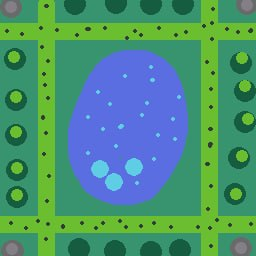

# robot-repair-Oliferuk
## Щоденник розробника
### 18.09.2026 — Лаба 2 

Створив сцену, додав персонажа, намалював все тайлмапом і зробив простенький біг. 

Нічого складного наче так не було.
З розділу **More things to try** зробив два пункти:
1. Керування через джойстик.
2. Намалював піксельну сцену в Aseprite.

### 05.10.2026
**Що зроблено:**
* Налаштовано сортування графіки через параметр `Custom Axis (0, 1, 0)` та коригування точок `Pivot` у спрайтів для коректного перекриття об'єктів у 2D-просторі[cite: 2, 3].
* Створено префаби елементів оточення та небезпечних ділянок `DamageZone` із налаштуванням `Tiled` для масштабування текстур[cite: 3].
* Інтегровано та налаштовано компонент `Rigidbody 2D` для робота (вимкнено вплив гравітації та зафіксовано кут повороту)[cite: 4].
* Переведено керування персонажем на метод `FixedUpdate` із застосуванням `MovePosition`, що усунуло дрижання кадру при зіткненнях зі стінами.
* Налаштовано систему колізій карти за допомогою `Tilemap Collider 2D` та `Composite Collider 2D`, а також прибрано колайдери з тайлів землі (`Collider Type = None`).
* Реалізовано додаткові завдання («More things to try»): урізноманітнено рівень декоративними об'єктами та побудовано смугу перешкод із зон шкоди для активного маневрування.
### 09.10.2026

**Що зроблено:**
* **Юніт 3: система здоров'я (Лабораторна робота №4):**
  * Реалізував систему здоров'я (`maxHealth`, `currentHealth`) та функцію `ChangeHealth()` з `Mathf.Clamp`.
  * Створив аптечки (`HealthCollectible`) через тригер, які підбираються лише при неповному HP.
  * Налаштував зони шкоди (`DamageZone`) через `OnTriggerStay2D` та увімкнув `Never Sleep` на Rigidbody2D.
  * Додав механіку тимчасової невразливості (`isInvincible`, `timeInvincible`) після отримання шкоди.
  * **Додаткове ДЗ:** Створив хіл-зону (повільне відновлення здоров'я) та велику аптечку із підвищеним лікуванням.
### 26.11.2026 — Юніт 4: вороги і снаряди (Лабораторна робота №5)
**Що зроблено:**
* Створив префаб ворога `Enemy` (тригер-колайдер, `Rigidbody2D` без гравітації) і скрипт `EnemyController`: патруль за таймером (`changeTime`, `direction = -direction`), вибір осі через `vertical`, шкода на дотик через `OnTriggerEnter2D`.
* Анімації ворога: кліпи `EnemyLeft`, `EnemyRight` (Flip X), `EnemyFixed` (Samples = 4), Animator Controller з Blend Tree `2D Simple Directional` за параметрами `Move X` / `Move Y` і перехід у `EnemyFixed` по тригеру `Fixed`.
* Робот отримав Animator з контролером `Player`: `Look X`, `Look Y`, `Speed`, тригери `Hit` і `Launch`. Аркуш спрайтів робота перевів на PPU = 100, щоб анімований робот був того самого розміру, що й статичний.
* Снаряд `Projectile`: `AddForce`, постріл на клавішу C, шари `Character` і `Projectiles` із вимкненою колізією в Layer Collision Matrix. Влучання викликає `Fix()` — ворог зупиняється, грає анімацію полагодженого й більше не шкодить.

**More things to try (зроблено всі 4 пункти):**
1. Швидкий і повільний варіанти ворога — Prefab Variant `EnemyFast` (Speed 2, Change Time 1.5) і `EnemySlow` (Speed 0.7, Change Time 4).
2. Ворог, що випадково міняє вісь руху (`randomAxis`, `axisChangeChance`); після зміни осі він іде назад до точки старту, щоб не «розповзатися» по карті — `EnemyRandomAxis` на сцені.
3. Інший спосіб прибирати снаряди — таймер життя `lifeTime = 2 с`, як у невразливості.
4. Обмежений темп пострілів — `timeBetweenLaunches = 0.5 с`, поки C не діє.

**Що не вийшло або забрало найбільше часу:** аніматор у частини ворогів був «порожній» (`Animator is not playing an AnimatorController`) — префаб треба було перезберегти/переімпортувати після створення контролера.

**Що зрозумів про Animator, шари й Awake:** Animation — це кадри одного кліпу, а Animator — схема станів, яка вибирає кліп за параметрами. `Awake` снаряда виконується ще всередині `Instantiate`, тому `rigidbody2d` уже є, коли викликається `Launch`; у `Start` він був би `null`. Шари потрібні, бо снаряд народжується всередині колайдера робота — рушій просто не перевіряє пару Character × Projectiles.

**Які Speed і Change Time обрав:** базовий ворог 1 × 3 (маршрут 3 од., вистачає часу зреагувати новачкові), швидкий 2 × 1.5 (той самий маршрут, але треба цілитися наперед), повільний 0.7 × 4 — «легкий» ворог для розминки.

**Що робить мій снаряд з ворогом:** не знищує, а лагодить — вороги тут зламані машини, а робот їх ремонтує.

**Що робитиму далі:** юніт 5 — UI здоров'я, NPC і діалог.

### 26.11.2026 — Юніт 5: HUD, діалоги, ігровий цикл (Лабораторна робота №6)
**Що зроблено:**
* UI Toolkit: `GameUI.uxml` (рамка, портрет, смуга здоров'я `HealthBar` у `HealthBarContainer`), `NPCDialogue.uxml`, `EndScreen.uxml`; Panel Settings — Scale With Screen Size, 1920×1080.
* `UIHandler` — синглтон (`UIHandler.instance`): `SetHealthValue`, `DisplayDialogue`, `DisplayWinScreen`, `DisplayLoseScreen`. `PlayerController.ChangeHealth` оновлює смугу (`currentHealth / (float)maxHealth`).
* NPC: аркуш нарізано 2×2, кліп `NPC` (4 кадри/с), шар `NPC`, колайдер на нижню половину. Робот шукає NPC променем `Physics2D.Raycast` довжиною 1.5 у бік погляду; над NPC з'являється бульбашка з X, X показує репліку на 4 с.
* `GameManager`: здоров'я 0 → екран поразки, усі вороги полагоджені → екран перемоги; через 3 с `SceneManager.LoadScene`. `MainScene` додана в список сцен збірки.

**More things to try (зроблено 3 пункти):**
1. Другий NPC `NPC_Mechanic` зі своєю реплікою — текст у полі `dialogueText`, `DisplayDialogue(string)` пише його в Label.
2. Лічильник «Полагоджено x / N» у HUD — `UIHandler.UpdateRobotCounter()`, його викликає `Fix()` ворога.
3. Прапорець `gameOver` у `GameManager` — `Invoke` більше не ставиться в чергу щокадру.

**Що зрозумів:** синглтон — один екземпляр, доступний звідусіль через static-властивість, тому `PlayerController` не потребує посилання в Inspector. Для NPC — промінь, а не тригер, бо важливо, щоб робот *дивився* на NPC. `(float)` потрібен, бо ділення цілих дає 0 або 1.

**Що каже мій NPC:** пояснює мету — лагодити роботів шестернями; механік підказує, як цілитися у швидкого робота.

**Умови перемоги й поразки:** усіх ворогів полагоджено — перемога; здоров'я 0 — поразка; в обох випадках рівень починається знову.

### 26.11.2026 — Лабораторна 7: власний рівень
**Що зроблено:** нова сцена `MyLevel` (копія MainScene) — перша в списку сцен збірки. Тайлмап розширено до трьох ділянок по 24 тайли з проходами між ними; камера `CinemachineCamera` + `CinemachineConfiner2D` іде за роботом у межах рівня (окремий шар `CameraBounds`, який ні з чим не стикається). План рівня — `Docs/LevelPlan.md`, бланк аналізу та модифікації — `Docs/GameModificationSheet.md`.

**Три ділянки:** знайомство (повільний ворог і NPC з метою) → практика (два вороги + зона шкоди, аптечка після) → перевірка (два швидкі помаранчеві вороги, велика аптечка, NPC-механік).

**Варіант ворога:** `EnemyFast` — Prefab Variant від `Enemy`: Speed 2, Change Time 1.5 (той самий маршрут 3 од., але вдвічі швидше) і помаранчевий колір загрози, щоб відрізнити з першого погляду.

**Числа — у префабах:** `HealthCollectible.amount`, `DamageZone.damage` — велика аптечка й болючіша зона робляться значенням у полі, без нового скрипта.

**Що показав плейтест:** рівень проходиться за ~2 хв від репліки NPC до екрана перемоги; кулі не пролітають крізь NPC, тож у третій ділянці механіка треба обходити.

**Що робитиму далі:** механіка-твіст (лабораторна 8).
